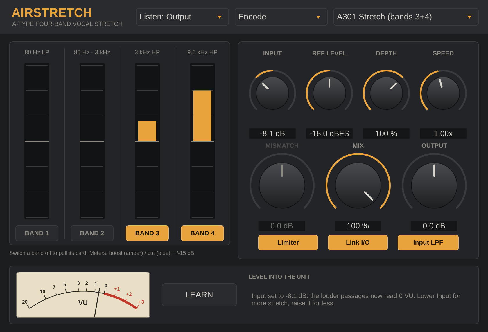

# AirStretch



A VST3 / AU plugin that models the four-band A-type noise-reduction processor used for the "vocal trick" (also called the stretch, vocal stressor, or pulled-card trick): the encode side chain used as an effect, never decoded.

## What it models

The model follows the Cat. 22 card schematic (drawing ADC 441) and is calibrated against the Model 361 instruction manual. Every signal first passes the card's input amplifier and low-pass filter. A side chain then splits into four bands, each with its own compressor and diode overshoot limiter, and the side chain is added to the dry signal.

| Band | Filter (from the schematic) | Typical role in the trick |
|---|---|---|
| 1 | 81 Hz low-pass, Sallen-Key, Q 0.73 | Usually pulled |
| 2 | 80 Hz – 3 kHz, derived by subtraction (input − band 1 − band 3) | Usually pulled |
| 3 | 2.98 kHz high-pass, Sallen-Key, Q 0.70 | Presence / sting |
| 4 | 9.58 kHz high-pass, Sallen-Key, Q 0.79 | Air |

**Compressors.** Each is a two-FET attenuator. Its detector rectifies the compressor's own output plus a small feed-forward share of its input (R126), so at high levels the correction signal turns *down*, as in the manual's Fig. 4.3c. The control law is fitted to the NRM test set's three compressor checks, and the model reproduces them:

| Test (manual §12.4) | Input | Spec | Model |
|---|---|---|---|
| GAIN | 2 mV | 16–18 mV | 17.0 mV |
| LAW 1 | 10 mV | 55–65 mV | 59.5 mV |
| LAW 2 | 50 mV | 67–77 mV | 72.7 mV |

**Control timing.** There are two non-linear integrators per band (manual §10.10): small changes move slowly, large changes pass quickly through diode bypasses.

| Bands | Pre-integrator (attack / release) | Final integrator | Fast paths |
|---|---|---|---|
| 1, 2 | 4 ms / 56 ms | 94 ms | 2 ms |
| 3, 4 | 2 ms / 27 ms | 47 ms | 1 ms |

**Input low-pass.** A Sallen-Key at 34.6 kHz (Q 1.31) plus two RC sections gives a gentle lift: about +0.4 dB at 10 kHz and +1.6 dB at 20 kHz.

### Measured against the manual

| Check | Spec | Model |
|---|---|---|
| Record test, −40 dB at 850 Hz | +9.5 to +10.5 dB | +9.95 dB |
| Play test, −40 dB at 850 Hz | −9.5 to −10.5 dB | −9.96 dB |
| Noise reduction, low level | 10 dB 30 Hz–5 kHz, 15 dB at 15 kHz | 10.0 dB at 30 Hz–1 kHz, 8.8 dB at 5 kHz, 13.7 dB at 15 kHz |
| THD at +8 dBm, 1 kHz | < 0.1 % | 0.000 % |
| THD at +8 dBm, 40 Hz–20 kHz | < 0.2 % | 0.043 % worst (40 Hz) |
| Overshoot, −40 → 0 dB burst | < 2 dB | 1.41 dB |
| Encode → decode | complementary | null below −270 dB |

Encode boost by level (all bands, steady sine, input filter excluded):

| Level re ref | 50 Hz | 1 kHz | 12 kHz |
|---|---|---|---|
| −40 dB | +10.0 | +9.9 | +12.8 |
| −30 dB | +8.5 | +7.5 | +10.6 |
| −20 dB | +4.3 | +2.6 | +5.4 |
| −10 dB | +1.7 | +0.2 | +2.2 |
| 0 dB | +0.5 | −0.3 | +0.7 |

Quiet breaths, consonants and decays get lifted far more than loud notes, which is why it sounds like "air" rather than EQ. Most of the lift lands between −40 and −20 dB, where a vocal's detail and tails sit.

## Controls

- **Mode**
  - *Encode*: the classic trick.
  - *Decode*: the playback side alone. Level-dependent downward expansion of the active bands (smooths sibilance and hiss on quiet passages).
  - *Encode > Decode*: a full encode/decode loop with a level offset (**Mismatch**) between them. Positive mismatch leaves a gentle level-dependent lift; negative mismatch gives expansion and pumping.
- **Band 1–4**: switch a band off to "pull the card". The default is bands 3 and 4 only, the A301 stretch.
- **Input**: level into the fixed threshold. Lower input means more of the signal sits below threshold, so more stretch; higher input means less effect.
- **VU meter and Learn** (bottom strip): the meter shows the level going into the unit, after Input, with 0 VU = reference level, like the 361's panel meter. The effect works on material below 0 VU; most of the lift happens 20–40 dB down, so a track hitting the unit too hot gets very little. Press **Learn** and play the track: after 5 seconds of audio (silence is skipped) it sets Input so the louder passages read 0 VU, the way an engineer aligned a vocal into the hardware. From there, lower Input for more stretch and raise it for less. With Link I/O on, none of this changes your loudness.
- **Ref Level**: the DAW level treated as Dolby Level (185 nWb/m, 0 VU on the unit; default −18 dBFS). It is a calibration control; **Input** is the performance control.
- **Link I/O**: when on, output is compensated by the Input amount so changing drive changes the effect, not the loudness.
- **Depth**: scales the low-level side-chain gain (100 % = +10 dB, up to 150 %).
- **Speed**: scales every band's attack and release (1.0x = the card's timing). Faster gives more movement and grab; slower is smoother.
- **Limiter**: the side-chain overshoot limiters. Turn off for spitty, unclipped transient boosts.
- **Input LPF**: the card's input low-pass filter and its slight top-end lift. On by default.
- **Mix**: parallel blend with the dry signal. Many engineers ran the stretched signal on a parallel fader.
- **Listen: Side Chain**: outputs only the added component (wet minus dry), for printing to its own track or sending to a reverb.
- **Output**: final trim.

Processing runs at 2× oversampling with low-latency IIR filters; latency is reported to the host.

## Factory presets

A301 Stretch (bands 3+4) · Full Card Encode · Air Only (band 4) · Presence + Air (bands 2–4) · Parallel Stretch · Deep Stretch (low drive) · Spitty (limiters off) · Side Chain Only (send) · Decode Smooth (de-ess) · Decode Full Card · Mismatch +6 (gentle lift) · Mismatch −6 (expand/pump)

## Building

Requirements: CMake 3.22+, a C++17 compiler (Xcode on macOS, Visual Studio 2022 on Windows), git.

```bash
cmake -S . -B build -DCMAKE_BUILD_TYPE=Release
cmake --build build --config Release --parallel
```

JUCE 8.0.4 is downloaded automatically. To use your own checkout, add `-DJUCE_DIR=/path/to/JUCE`.

Built plugins land in `build/AirStretch_artefacts/Release/` (VST3, AU on macOS, and a Standalone app). Copy them to:

- macOS: `~/Library/Audio/Plug-Ins/VST3/` and `~/Library/Audio/Plug-Ins/Components/`
- Windows: `C:\Program Files\Common Files\VST3\`

Or set `COPY_PLUGIN_AFTER_BUILD TRUE` in `CMakeLists.txt` to install on every build.

Run `build/EngineTest` (or `build\Release\EngineTest.exe`) to print the boost curves and run the null test.

### Building without a dev setup

Push this folder to a GitHub repository. The included workflow (`.github/workflows/build.yml`) builds macOS (universal) and Windows binaries and attaches them to each run under **Actions → Artifacts**.

On macOS, unsigned downloaded plugins are quarantined; clear it with `xattr -cr ~/Library/Audio/Plug-Ins/VST3/AirStretch.vst3` (and the `.component`). Notarised distribution needs an Apple Developer ID.

### Cross-compiling the Windows VST3 from Linux

`scripts/build-windows-mingw.sh` builds the Windows VST3 on a Linux machine with llvm-mingw. It downloads the toolchain and JUCE, applies three small MinGW patches to JUCE, and builds and strips the plugin:

```bash
scripts/build-windows-mingw.sh            # work files go in ./build-mingw-work
```

JUCE 8 no longer officially supports MinGW ("Support for MinGW has been removed" appears during the build), so treat this as a convenience build. For releases, use MSVC through the GitHub Actions workflow. The plugin links its C++ runtime statically and imports only Windows system DLLs, including the Universal C Runtime (part of Windows 10 and 11).

### OS X 10.8 Mountain Lion build (Pro Tools 11 through PatchWork)

For older Macs there is a separate legacy build: OS X 10.8 minimum, 64-bit Intel, VST3 and AU. It's meant for hosts like Pro Tools 11, which only loads AAX, through a wrapper such as Blue Cat PatchWork, so it needs no AAX SDK or PACE signing.

JUCE 7 and later need macOS 10.9+, so this build uses JUCE 6.1.6 (the source builds on both; `Source/JuceCompat.h` covers the differences):

```bash
cmake -S . -B build-legacy -DCMAKE_BUILD_TYPE=Release -DAIRSTRETCH_LEGACY_MAC=ON -DAIRSTRETCH_BUILD_TESTS=OFF
cmake --build build-legacy --config Release
scripts/check-legacy-mac.sh build-legacy/AirStretch_artefacts/Release
```

The GitHub workflow's **macOS 10.8 legacy** job does all of this and uploads `AirStretch-macOS-10.8-legacy`, containing a VST3 zip and an AU zip. Unzip on the Mountain Lion Mac and copy:

- `AirStretch.vst3` → `/Library/Audio/Plug-Ins/VST3/`
- `AirStretch.component` → `/Library/Audio/Plug-Ins/Components/`

Then rescan plugins in PatchWork, and load whichever format it lists.

Caveats:

- Apple's current Xcode officially targets macOS 10.13 and up. The job uses the oldest Xcode on GitHub's runner and `check-legacy-mac.sh` confirms the binaries are Intel-only, stamped for 10.8, free of newer binary formats, and linked only to libraries that exist on 10.8. That's strong evidence, but only the Mountain Lion machine can prove they load.
- A Mac running High Sierra to Catalina with Xcode 9.2–11 is the officially supported way to build for 10.8, if one becomes available.
- JUCE 6 is licensed GPLv3 or commercial, like JUCE 8.

### Before releasing

- Set `COMPANY_NAME`, `BUNDLE_ID` and `PLUGIN_MANUFACTURER_CODE` in `CMakeLists.txt`.
- JUCE 8 is dual-licensed (AGPLv3 or commercial). Closed-source distribution needs a JUCE licence.
- "Dolby" is a trademark of Dolby Laboratories. Keep it out of the product name and artwork; describing the technique as "A-type" is the usual approach.

## Code layout

- `Source/dsp/LevelTools.h`: the VU meter ballistics and the Learn statistics, framework-free.
- `Source/dsp/TypeAEngine.h`: the whole model, framework-free. Band filters, compressor law, overshoot limiter, encode and the delay-free decode solve.
- `Source/PluginProcessor.*`: parameters, presets, oversampling, modes, mix and metering.
- `Source/JuceCompat.h`: the few API differences between JUCE 6 (legacy Mac build) and JUCE 8.
- `Source/PluginEditor.*`: the interface: four band "cards" with boost/cut meters, controls on the right.
- `tests/EngineTest.cpp`: the manual's acceptance tests (compressor GAIN/LAW checks, record/play tests, distortion, overshoot) plus curve tables, the encode/decode null, the input filter, VU calibration and Learn alignment.

## Where the model is approximate

From the schematic and manual: band filters, band 2 by subtraction, the compressor law (fitted to the test-set checks), mixed feedback/feed-forward detection, both integrators with their diode fast paths, the clipper knee, the input low-pass, and the absolute level calibration.

Still estimated:

- **Input-to-compressor gain.** The manual gives module levels and compressor levels but not the gain between them. Unity gain (a chain of followers) is the value that also gives the specified 2:1 maximum compression slope near −30 dB, so the model uses it.
- **Diode behaviour.** Integrator and clipper diodes are modelled as thresholds with resistance, converted to signal units using the manual's control-voltage readings (3.1 / 3.5 / 3.7 V).
- **The addition-stage limiter** (D531/D532), which only acts when several bands clip on the same transient, is not modelled.
- **Ref level and +8 dBm.** The THD check assumes 0 VU = +4 dBm, so +8 dBm is +4 dB above reference.

Two results differ slightly from the spec sheet's round numbers, and both follow directly from the card's filters: 8.8 dB at 5 kHz, where band 4's high-pass is out of phase below its cutoff, and 13.7 dB at 15 kHz. With bands 3 and 4 alone there is also a ~2 dB low-level dip around 1 kHz, for the same reason with band 3. The FET distortion is cancelled on the card (half the drain signal is fed back to the gate), so the model leaves it out.
